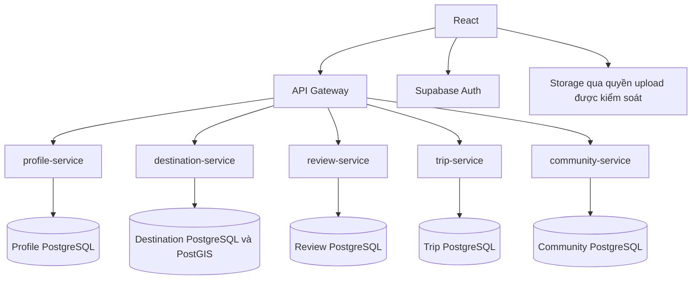

# Kế hoạch triển khai hoàn thiện VietnamTourism

Phiên bản 1.0, ngày 20/11/2026 (Asia/Saigon). Mục tiêu là hoàn thành hành trình tìm địa điểm → xem bản đồ → lưu → lập lịch trình → chia sẻ, với backend Java/Quarkus microservice và từng service được đóng gói Docker độc lập.

- Yêu cầu sản phẩm: [PROJECT_SPEC.md](PROJECT_SPEC.md), phiên bản 1.4.
- Quyết định kiến trúc: [ADR-001](docs/architecture/ADR-001-backend-microservices.md).
- Quy định thực hiện và báo cáo: [AGENTS.md](AGENTS.md).
- Trạng thái cập nhật 21/11/2026: P0-01…04 đang được triển khai; xem trạng thái từng dòng và [bản ghi nghiệm thu](docs/verification/README.md). P0-02 còn chờ kiểm chứng Supabase thật; không coi toàn P0 đã hoàn thành.

Đặc tả quyết định hành vi và nghiệm thu; ADR quyết định kiến trúc; kế hoạch này quyết định đầu việc, phụ thuộc và bằng chứng tiến độ. Không đổi phạm vi sản phẩm bằng cách chỉ sửa bảng công việc.

## 1. Kiến trúc triển khai

| Thành phần | Phạm vi |
| --- | --- |
| React | Giao diện khách, tài khoản, lịch trình, cộng đồng và quản trị; TypeScript, Vite, Tailwind, React Router, TanStack Query |
| Gateway | Route `/api/v1`, giới hạn truy cập phù hợp, request ID và chuyển tiếp API; không chứa nghiệp vụ/domain database |
| profile-service | Hồ sơ công khai/riêng tư, quyền và trạng thái ứng dụng, tham chiếu subject của Auth |
| destination-service | Tỉnh/thành, địa điểm, nội dung, tìm kiếm địa lý và tên thay thế |
| review-service | Đánh giá, ảnh đánh giá, hữu ích, báo cáo và tổng hợp điểm |
| trip-service | Yêu thích, bộ sưu tập, lịch trình, ngày đi, dự toán và quyền chia sẻ |
| community-service | Bài viết, bình luận, lượt thích, theo dõi, feed và kiểm duyệt cộng đồng |
| PostgreSQL | Database logic/tài khoản/migration theo từng service; PostGIS cho destination-service |
| Supabase | Auth và Storage theo phương án cơ sở; có thể hosting PostgreSQL nếu phù hợp điều kiện kết nối |



Mỗi Quarkus service có image riêng và kiểm tra JWT/quyền riêng; các database logic có thể cùng PostgreSQL instance ở môi trường phát triển. FE không ghi trực tiếp bảng nghiệp vụ qua Supabase. Admin gọi API service sở hữu nội dung.

MongoDB chưa nằm trên đường triển khai bắt buộc. Chỉ xem xét tại P3-07 nếu mô hình đọc feed có nhu cầu/đo lường rõ. Nhà cung cấp ảnh nền bản đồ được chọn tại P1-05; PostGIS xử lý dữ liệu địa lý, không thay nhà cung cấp bản đồ. Kafka, Redis và Kubernetes không là điều kiện bắt buộc của bản đầu.

## 2. Cấu trúc repository mục tiêu

Giữ frontend hiện có tại `src/` trong giai đoạn chuyển đổi để hạn chế thay đổi đường dẫn ngoài phạm vi. Tạo backend dần theo từng giai đoạn, không cần tạo các service rỗng để tính tiến độ.

```text
src/                               Frontend React đang có
services/
  profile-service/
  destination-service/
  review-service/
  trip-service/
  community-service/
infra/
  gateway/
  postgres/                        Khởi tạo database/role phát triển
tests/
  e2e/                             Luồng trình duyệt xuyên hệ thống
docs/
  architecture/
  operations/                      Hướng dẫn chạy, migrate, backup, release
  verification/                    Bằng chứng nghiệm thu theo giai đoạn
compose.yaml                       Môi trường phát triển/tích hợp
.github/workflows/                 CI của FE và từng service
```

Mỗi thư mục Java khi được tạo phải có build Maven/Wrapper dùng được độc lập, source/test, migrations, Dockerfile và `.dockerignore`. Có thể dùng BOM/quy ước chung; không chia sẻ entity, repository hoặc database giữa service. Các đường dẫn trong sơ đồ là đích triển khai, chưa phải file đã có.

## 3. Mốc hoàn thành và ước lượng

Ước lượng sơ bộ cho một lập trình viên toàn thời gian đã quen React/Java, tái sử dụng FE hiện tại và có quyền truy cập môi trường phát triển: **10–16 tuần làm việc**. Thời gian cấp tài khoản/hạ tầng, chờ nội dung hoặc thay đổi phạm vi có thể kéo dài lịch; đánh giá lại sau P0. Đây là ước lượng kế hoạch, không phải cam kết ngày phát hành hay thời gian chạy agent.

| Giai đoạn | Ước lượng | Sản phẩm có thể nghiệm thu |
| --- | --- | --- |
| P0 | 2–3 tuần | Đăng nhập, đọc hồ sơ qua gateway/Quarkus/JPA, chạy bằng Docker, quyền truy cập và CI nền |
| P1 | 2–3 tuần | Khám phá, tìm kiếm, bản đồ, chi tiết và lưu địa điểm bằng API mới |
| P2 | 2–3 tuần | Hồ sơ đầy đủ, ảnh, bộ sưu tập, đánh giá và quản trị nội dung |
| P3 | 3–4 tuần | Lịch trình nhiều ngày, chia sẻ, bài viết, bình luận, theo dõi và feed |
| P4 | 1–3 tuần | Chuyển đổi dữ liệu hoàn tất, kiểm thử xuyên suốt, staging và vận hành phát hành |

Trình tự bắt buộc P0 → P1 → P2 → P3 → P4. Công việc nội dung/tài liệu độc lập có thể chuẩn bị sớm, nhưng không bỏ điều kiện kết thúc giai đoạn. Kiểm thử và Docker được làm cùng chức năng, không dồn tới P4.

## 4. P0 xây nền tảng backend và môi trường

Tham chiếu TECH-01 đến TECH-04, SEC-01, AUTH-01 và PROFILE-01 phần đọc hồ sơ. Kết quả đầu tiên phải là một luồng hoạt động xuyên FE/BE/database.

| Mã | Công việc và đầu ra cần kiểm tra | Phụ thuộc | Trạng thái |
| --- | --- | --- | --- |
| P0-01 | Kiểm tra Git/toolchain, Docker Engine, Node, JDK/Maven; khóa phiên bản tương thích trong cấu hình/Wrapper và CI. Có `.env.example`, phân biệt local/staging/production, hướng dẫn chuẩn bị Auth/Storage. | Không | Hoàn thành — [bản ghi và giới hạn](docs/verification/P0-01.md) |
| P0-02 | Kiểm kê dữ liệu/query/trigger Supabase; phân loại mock/thật, công khai/riêng; lập phương án export/restore. Chuẩn bị và kiểm thử migration sửa policy quyền yếu của các miền còn phục vụ FE cũ, giữ quyền hợp lệ trong lúc chuyển đổi; áp dụng vào môi trường được phép theo runbook, không chạy script DROP. | P0-01 | Hoàn thành — owner inventory project rỗng, apply migrations/RLS probe hosted đạt; [bản ghi](docs/verification/P0-02.md) |
| P0-03 | Chốt API v1, ID/slug, pagination, filter/sort, định dạng lỗi/request ID, timestamp UTC và chi phí VND; xác định vai trò, chủ sở hữu và hợp đồng gọi giữa service. Có OpenAPI ban đầu và quy tắc thay đổi tương thích. | P0-02 | Hoàn thành — hợp đồng ban đầu chuẩn bị độc lập khi P0-02 chờ môi trường; [bản ghi](docs/verification/P0-03.md) |
| P0-04 | Tạo profile-service Quarkus và gateway; resource/DTO/application service/repository tách rõ. Có health/readiness, log và timeout; service build/test độc lập. | P0-03 | Hoàn thành — khung, 10/10 test, Linux images/gateway smoke đạt; JPA/JWT ở P0-05/06, [bản ghi](docs/verification/P0-04.md) |
| P0-05 | Tạo PostgreSQL phát triển với database/tài khoản profile-service và Flyway; tách runtime/migration role. Schema hồ sơ công khai/riêng, quyền/trạng thái; kiểm tra không truy cập database service khác. | P0-04 | Hoàn thành local — 17/17 test, [bản ghi](docs/verification/P0-05.md); init/volume Compose kiểm ở P0-08 |
| P0-06 | Tích hợp xác thực Supabase JWT tại service, bootstrap hồ sơ idempotent cho subject hợp lệ, xử lý username trùng và quyền admin có nguồn tin cậy. Không cấp quyền từ metadata người dùng tự sửa. | P0-05 | Hoàn thành API local — ES256/JWKS, 24/24 test; provider thật nghiệm thu ở P0-10, [bản ghi](docs/verification/P0-06.md) |
| P0-07 | Hoàn thiện FE đăng ký/xác nhận email/đăng nhập/đăng xuất/quên/đặt lại mật khẩu; API client đính token, xử lý 401/403, refresh lỗi, trả lại URL/bộ lọc; sinh types từ OpenAPI. Xóa cache cá nhân khi đổi tài khoản. | P0-06 | Hoàn thành FE local — 13 unit + 5 browser tests; provider thật ở P0-10, [bản ghi](docs/verification/P0-07.md) |
| P0-08 | Dockerfile riêng cho profile-service, FE, gateway; Compose với PostgreSQL, volume, DNS nội bộ và cấu hình mẫu. Runtime non-root, không secrets; migration có một bước chạy được kiểm soát. | P0-05 | Hoàn thành local — build/run, volume/recreate/outage/role đạt, [bản ghi](docs/verification/P0-08.md) |
| P0-09 | CI ban đầu: FE build/lint, Quarkus test với PostgreSQL và JWT test fixtures, migration/role tests, contract check; tạo một smoke test Playwright cho đăng nhập/đọc hồ sơ trên môi trường test. | P0-07, P0-08 | Đã cấu hình/kiểm local; chờ CI hosted của commit mới, [bản ghi](docs/verification/P0-09.md) |
| P0-10 | Kiểm chứng luồng React → gateway → Quarkus → JPA → PostgreSQL bằng tài khoản test; thử khách/A/B/admin và token lỗi/hết hạn. Đóng đường vòng miền profile đã chuyển; kiểm tra policy an toàn cho các miền chưa chuyển đang phục vụ FE cũ. Ghi bằng chứng, lệnh chạy và giới hạn. | P0-02, P0-09 | Chưa bắt đầu |

**Điều kiện kết thúc P0:** clone sạch có thể dựng stack khi được cung cấp cấu hình test; đăng nhập và đọc hồ sơ hoạt động; khách/A/B/admin đúng quyền; không lộ thông tin riêng; CI nền đạt; migration và dữ liệu tồn tại sau tạo lại container. Bộ JWT fixture chỉ chứng minh logic test, không thay kiểm tra kết nối Auth thật trên staging.

## 5. P1 hoàn thiện khám phá và lưu địa điểm

Tham chiếu HOME-01, DISC-01, DEST-01, MAP-01, SEARCH-01 phần địa điểm/tỉnh, SAVE-01 phần lưu cơ bản, DATA-01/02/03 và UX-01/02/03.

| Mã | Công việc và đầu ra cần kiểm tra | Phụ thuộc | Trạng thái |
| --- | --- | --- | --- |
| P1-01 | Tạo destination-service, database/Flyway/JPA, PostGIS, tìm kiếm/index, Dockerfile/CI. Schema địa điểm, tỉnh, tên thay thế, ảnh, nguồn/ngày cập nhật, xuất bản. Có validation và API quản trị cần cho nhập nội dung. | P0-10 | Chưa bắt đầu |
| P1-02 | Chuyển danh mục hành chính, ánh xạ 63 tên cũ/slug sang đơn vị hiện hành và địa danh du lịch; giữ ID hoặc bảng đối chiếu. Chuẩn bị 30–50 địa điểm đủ trường, ảnh đúng nơi, nguồn/quyền ảnh. | P1-01 | Chưa bắt đầu |
| P1-03 | API danh sách/chi tiết, lọc ngân sách/mùa/vùng/loại, sắp xếp/phân trang; tìm có/không dấu và tên cũ/mới; truy vấn địa điểm trong vùng bản đồ/gần tọa độ. Kiểm tra ký tự đặc biệt và giới hạn truy vấn. | P1-01, P1-02 | Chưa bắt đầu |
| P1-04 | Chuyển FE khám phá/chi tiết/tìm kiếm sang API mới và TanStack Query; bộ lọc trên URL, Back/refresh đúng. Chuẩn hóa các trạng thái và loại bỏ query Supabase trực tiếp của miền địa điểm. | P1-03 | Chưa bắt đầu |
| P1-05 | Chọn nhà cung cấp bản đồ theo dữ liệu/điều khoản/chi phí; dùng marker thật, cluster và đồng bộ danh sách/bộ lọc. Kiểm tra mobile, bàn phím và lỗi tải. Không tự đăng ký gói trả phí. | P1-03, P1-04 | Chưa bắt đầu |
| P1-06 | Tạo trip-service phần yêu thích với PostgreSQL/JPA/Flyway và Dockerfile/CI; API lưu/bỏ lưu idempotent, constraint chống trùng; FE đồng bộ trạng thái, rollback khi lỗi. | P0-10, P1-03 | Chưa bắt đầu |
| P1-07 | Trang chủ dùng địa điểm thật, CTA và thống kê có nguồn; ẩn phần chưa có dữ liệu. Áp dụng token giao diện/tiếng Việt, responsive, focus/nhãn. Kiểm tra sớm hướng metadata trang công khai để chọn cách tiền kết xuất ở P4. | P1-04, P1-06 | Chưa bắt đầu |
| P1-08 | Kiểm thử tìm → lọc → bản đồ → chi tiết → lưu → tải lại; đối chiếu dữ liệu, redirect slug cũ và quyền lưu. Ngừng đường ghi cũ của miền đã chuyển sau khi xác minh không phá phần chưa chuyển. | P1-02 đến P1-07 | Chưa bắt đầu |

**Điều kiện kết thúc P1:** dữ liệu thật hiển thị thống nhất giữa danh sách/bản đồ/chi tiết; từ khóa có/không dấu và tên cũ tìm được đích; lưu bền vững, không trùng; các image service mới chạy được trong Compose; chưa có đánh giá thật thì không hiển thị điểm mẫu như điểm thực.

## 6. P2 hoàn thiện hồ sơ đánh giá và quản trị

Tham chiếu PROFILE-01, SAVE-01 đầy đủ, REVIEW-01, ADMIN-01 phần nội dung hiện có, BIZ-01 đến BIZ-09 và UX.

| Mã | Công việc và đầu ra cần kiểm tra | Phụ thuộc | Trạng thái |
| --- | --- | --- | --- |
| P2-01 | Hồ sơ sửa/lưu đầy đủ; phân biệt public/private, tên/ảnh đồng bộ; quyền riêng tư và trạng thái tài khoản. Profile API không lộ liên hệ hoặc cho thay quyền qua payload hồ sơ. | P1-08 | Chưa bắt đầu |
| P2-02 | Luồng upload ảnh dùng Storage: yêu cầu upload, quyền/phạm vi, kiểm tra loại/dung lượng thực, xác nhận hoàn tất và xóa tệp dư phù hợp. Hoàn thiện avatar/cover và thành phần upload dùng lại. | P2-01 | Chưa bắt đầu |
| P2-03 | Bộ sưu tập trong trip-service, thêm/bỏ địa điểm, tên và quyền công khai; mặc định riêng tư. FE quản lý đã lưu/bộ sưu tập và kiểm tra truy cập A/B/khách. | P2-01 | Chưa bắt đầu |
| P2-04 | Tạo review-service, database/Flyway/JPA/Dockerfile/CI; CRUD đánh giá, một bản hiện hành/người/địa điểm, ảnh/ngày trải nghiệm, hữu ích/báo cáo. Có ràng buộc tại database và kiểm tra API. | P1-08, P2-02 | Chưa bắt đầu |
| P2-05 | Tính điểm/số lượt từ đánh giá hợp lệ; ghép dữ liệu qua API có chủ sở hữu, không join chéo. FE danh sách/form sửa/xóa, ảnh, hữu ích và báo cáo; điểm thay đổi đúng khi ẩn/xóa. | P2-04 | Chưa bắt đầu |
| P2-06 | Quản trị địa điểm, ảnh, nội dung nổi bật, đánh giá và báo sai; mỗi service ghi audit của miền mình. Dashboard dùng số thật, có role guard/API permission và trạng thái xuất bản. | P2-02, P2-05 | Chưa bắt đầu |
| P2-07 | Kiểm tra đường công khai sau ẩn nội dung/đổi quyền; chặn tài khoản và giới hạn ghi chống lạm dụng phù hợp. Kiểm tra IDOR, payload đổi owner/role, upload trái quyền và gọi API trực tiếp. | P2-03, P2-06 | Chưa bắt đầu |
| P2-08 | Đối chiếu và chuyển hồ sơ/yêu thích/review còn dùng backend cũ; xác định xử lý profile mock, rating và counter mẫu. Đóng đường ghi cũ theo miền; chạy test và nghiệm thu P2. | P2-07 | Chưa bắt đầu |

**Điều kiện kết thúc P2:** người dùng chỉnh hồ sơ, upload, tổ chức bộ sưu tập và đánh giá được; admin quản lý nội dung bằng API đúng quyền; tải lại giữ dữ liệu; không xuất hiện dữ liệu riêng qua endpoint công khai hoặc URL ảnh; audit truy vết được.

## 7. P3 xây lịch trình và cộng đồng đầy đủ

Tham chiếu TRIP-01, SOCIAL-01, SEARCH-01 phần bài/người, HOME-01 hoàn chỉnh và ADMIN-01 cho nội dung cộng đồng.

| Mã | Công việc và đầu ra cần kiểm tra | Phụ thuộc | Trạng thái |
| --- | --- | --- | --- |
| P3-01 | Mở rộng trip-service: chuyến đi/ngày/địa điểm, thứ tự, ghi chú, chi phí VND; thao tác nguyên tử trong service, xử lý cập nhật đồng thời và validation ngày/thứ tự. | P2-08 | Chưa bắt đầu |
| P3-02 | FE tạo/chỉnh chuyến đi, thêm từ khám phá/đã lưu, đổi thứ tự và tổng dự toán. Không bắt buộc kéo thả để sắp xếp; tải lại/đổi thiết bị giữ đúng dữ liệu. | P3-01 | Chưa bắt đầu |
| P3-03 | Quyền chia sẻ chỉ xem, thu hồi, preview/bản in; không công khai ngoài ý muốn, không sửa qua URL chia sẻ. Kiểm tra cache sau thu hồi và liên kết cũ. | P3-02 | Chưa bắt đầu |
| P3-04 | Tạo community-service với PostgreSQL/JPA/Flyway/Dockerfile/CI; bài viết gắn địa điểm, ảnh, bình luận, lượt thích và follow/unfollow. Ràng buộc chống trùng, phân trang, báo cáo/kiểm duyệt và audit theo miền. | P2-08 | Chưa bắt đầu |
| P3-05 | FE đăng/sửa/xóa bài, bình luận, theo dõi, hồ sơ công khai và feed; quyền tác giả, loading/lỗi, lọc nội dung đã ẩn. Không tự đăng hoạt động yêu thích. | P3-04 | Chưa bắt đầu |
| P3-06 | Tìm bài/người qua API service sở hữu; hoàn thiện trang chủ lịch trình/trải nghiệm, dashboard và quản trị cộng đồng. Dữ liệu tổng hợp không làm lộ phần riêng hoặc phụ thuộc join database. | P3-03, P3-05 | Chưa bắt đầu |
| P3-07 | Đánh giá nhu cầu mô hình đọc feed/MongoDB bằng truy vấn/dữ liệu đo được. Mặc định giữ PostgreSQL. Nếu cần đổi, ghi ADR bổ sung được duyệt rồi mới thêm MongoDB/event transport/outbox/rebuild; công việc này hoàn thành bằng quyết định có căn cứ, không bắt buộc cài MongoDB. | P3-05 | Chưa bắt đầu |
| P3-08 | Kiểm thử chuyến đi 3 ngày, chia sẻ/thu hồi, bài viết/bình luận/theo dõi, ẩn nội dung và lỗi service phụ thuộc. Kiểm tra dữ liệu tổng hợp và quyền giữa các module; ghi nghiệm thu P3. | P3-06, P3-07 | Chưa bắt đầu |

**Điều kiện kết thúc P3:** hoàn thành hành trình sản phẩm từ khám phá đến lịch trình và chia sẻ; liên kết chỉ xem không cho sửa; thu hồi quyền có hiệu lực; follow/bình luận lưu thật; mỗi service mới build/run độc lập; feed không phát lại nội dung riêng/đã ẩn.

## 8. P4 ổn định và chuẩn bị phát hành

Tham chiếu OPS-01, UX-01/02/03 và DONE-01 đến DONE-09. Các chức năng phải đã được kiểm thử theo từng giai đoạn; P4 xử lý kiểm chứng toàn hệ thống và vận hành phát hành.

| Mã | Công việc và đầu ra cần kiểm tra | Phụ thuộc | Trạng thái |
| --- | --- | --- | --- |
| P4-01 | Đối chiếu toàn bộ dữ liệu/quan hệ/ID/quyền và chức năng cũ; hoàn tất đóng đường nghiệp vụ Supabase Data API không dùng. Xóa code/mock thừa sau khi xác minh caller; ghi kế hoạch xử lý nguồn dữ liệu cũ. | P3-08 | Chưa bắt đầu |
| P4-02 | Chạy bộ test FE/BE/API/database/Storage/E2E đầy đủ; kiểm tra khách/A/B/admin, account switch, expired JWT và service account. Lỗi chặn nghiệm thu phải được sửa rồi chạy lại phạm vi liên quan. | P4-01 | Chưa bắt đầu |
| P4-03 | Hoàn thiện tiền kết xuất/metadata trang công khai theo khảo sát P1: title/description/OG, sitemap, canonical/redirect và deep link. Kiểm tra HTML/response mà bot chia sẻ nhận được. | P4-01 | Chưa bắt đầu |
| P4-04 | Đo hiệu năng bằng dataset và cấu hình ghi rõ; tối ưu query/index, phân trang, request thừa, bundle, ảnh, cache và bộ nhớ container. Ghi tải thử/budget phù hợp trước phép đo, không chỉ tăng ngưỡng cảnh báo. | P4-02, P4-03 | Chưa bắt đầu |
| P4-05 | Kiểm tra UI 375/768/1024/1440, bàn phím, form, focus, ảnh lỗi và reduced motion; rà toàn bộ nút/CTA/trang để loại thao tác chưa có xử lý và nội dung mẫu. | P4-02 | Chưa bắt đầu |
| P4-06 | CI build/test/image theo service; cấu hình staging, secrets/runtime, TLS, readiness, request ID/log, migration job và tag phát hành. Kiểm thử lỗi phụ thuộc, thay image riêng và tương thích schema. | P4-04, P4-05 | Chưa bắt đầu |
| P4-07 | Hoàn thiện README/hướng dẫn database, môi trường, migration, vận hành, backup/restore và rollback ứng dụng. Thử dựng sạch và phục hồi bản sao database; ghi quy trình Storage riêng. | P4-06 | Chưa bắt đầu |
| P4-08 | Nghiệm thu trên staging bằng kịch bản sử dụng; đối chiếu DONE-01…09, lập danh sách tồn đọng/bằng chứng và release candidate. Phát hành production khi người dùng đã cho phép, sau đó smoke test và theo dõi lỗi theo runbook. | P4-07 | Chưa bắt đầu |

**Điều kiện kết thúc P4:** các yêu cầu bắt buộc có bằng chứng đạt; có release candidate tái lập được, dữ liệu/ảnh khôi phục được và hướng dẫn vận hành thực hiện được. Nếu chưa có môi trường production được phép dùng, ghi rõ trạng thái sẵn sàng phát hành, không báo đã triển khai production.

## 9. Quy trình chuyển dữ liệu và ngừng API cũ

Áp dụng cho từng miền, không chờ tới cuối mới xem xét migration:

1. **Kiểm kê:** bảng/cột, query/trigger, số lượng dữ liệu, ID/slug, liên kết ảnh và chính sách truy cập. Xác định mock/demo, dữ liệu thật và quyền sở hữu.
2. **Chuẩn bị:** schema/Flyway mới, bảng ánh xạ ID nếu cần, dữ liệu thử và kịch bản rollback. Chụp/export dữ liệu được phép và thử restore vào môi trường cách ly.
3. **Chuyển thử:** import vào database service, đối chiếu số bản ghi, quan hệ, quyền riêng tư, nội dung ảnh và aggregate. Không mặc định tài khoản mock trong `profiles` là tài khoản Auth thật.
4. **Chuyển ứng dụng:** FE dùng API mới theo miền. Quy định rõ một nơi ghi dữ liệu nguồn tại mỗi thời điểm; nếu có khoảng dừng ghi, thông báo và đưa vào runbook khi triển khai.
5. **Xác minh:** kiểm thử người dùng/luồng quản trị, dữ liệu đã lưu, slug cũ và ảnh. Chỉ thu hồi đường ghi/grants cũ của phần đã chuyển, giữ Auth/Storage và phần còn cần theo chính sách.
6. **Ổn định:** theo dõi lỗi và đối chiếu; chỉ loại bỏ mã/tài nguyên cũ sau khi đáp ứng điều kiện chuyển đổi. Backup và kế hoạch khôi phục là một phần đầu ra, không phải thao tác xóa nhanh khi có lỗi.

Đánh giá/số lượt/điểm mẫu không được trở thành thống kê thật sau import. Tổng điểm do review-service quản lý; dữ liệu hiển thị ở service khác phải qua API/hợp đồng đồng bộ. `@Transactional` chỉ bảo vệ transaction phù hợp trong service, không biến các REST call thành một transaction chung.

## 10. Hợp đồng và kiểm thử

Quy ước API được ghi ở P0-03, trước khi triển khai các miền tiếp theo:

- `/api/v1`, DTO rõ, validation ở backend, lỗi có mã/thông điệp/request ID và phân biệt 400/401/403/404/409/5xx phù hợp.
- Danh sách có giới hạn/phân trang, sort/filter rõ; tìm kiếm dùng tham số an toàn. API ghi quan trọng có chống gửi lặp/concurrency phù hợp.
- Mỗi service xác minh JWT/quyền; không tin `userId`, vai trò hoặc header định danh client tự khai báo.
- Không join database chéo; lấy dữ liệu liên quan bằng API theo batch khi cần. Gọi giữa service có timeout và danh tính/quyền rõ; lỗi không được biến thành danh sách rỗng thành công.
- Hành vi khi nội dung ẩn, địa điểm ngừng xuất bản, tài khoản bị khóa hoặc chuyến đi ngừng chia sẻ phải được xác định trong từng hợp đồng.

| Lớp | Công cụ dự kiến | Phạm vi kiểm chứng |
| --- | --- | --- |
| Logic BE/API | Quarkus test/JUnit, REST Assured | Validation, nghiệp vụ, mã lỗi, JWT/quyền, DTO/hợp đồng |
| Persistence | PostgreSQL/PostGIS thực trong môi trường test, Dev Services/Testcontainers khi phù hợp | Flyway, constraint, query, transaction, ownership role |
| Logic FE | Vitest và thư viện kiểm tra component phù hợp | URL/filter, cache/account switch, form và trạng thái lỗi có nhánh |
| E2E | Playwright | Luồng trình duyệt đi qua API/database; mobile viewport và bàn phím |
| Container | Docker Compose và smoke test | Build, readiness, network, migration, persistence, cập nhật riêng |

Khóa phiên bản tương thích khi thiết lập hạ tầng test. Mock hữu ích để kiểm tra lỗi xác định được; không dùng mock làm bằng chứng duy nhất cho JPA/PostgreSQL, Auth thật hoặc E2E tích hợp.

## 11. Đối chiếu yêu cầu và công việc

| Yêu cầu | Công việc chịu trách nhiệm chính |
| --- | --- |
| HOME-01 | P1-07, P3-06, P4-03/P4-05 |
| DISC-01, DEST-01 | P1-01…04, P1-08, P2-06 |
| MAP-01 | P1-03, P1-05, P1-08 |
| SEARCH-01 | P1-03/P1-04, P3-06 |
| AUTH-01 | P0-06/P0-07/P0-10, P4-02 |
| PROFILE-01 | P0-05/P0-06, P2-01/P2-02/P2-08 |
| SAVE-01 | P1-06, P2-03/P2-08 |
| REVIEW-01 | P2-04/P2-05/P2-07/P2-08 |
| SOCIAL-01 | P3-04…08 |
| TRIP-01 | P3-01…03, P3-08 |
| ADMIN-01 | P0-06/P0-10, P1-01, P2-06/P2-07, P3-06 |
| DATA-01, DATA-02, DATA-03 | P0-02/P0-05, P1-01/P1-02, migrations từng service, P4-01 |
| UX-01, UX-02, UX-03 | P1-04/P1-05/P1-07, các công việc FE từng giai đoạn, P4-05 |
| TECH-01, TECH-02, TECH-03, TECH-04 | P0-01…09, mỗi lần thêm service, P4-06/P4-07 |
| SEC-01, BIZ-01…09 | P0-03/P0-06/P0-10, quyền/constraint/ảnh từng miền, P2-07, P4-02 |
| OPS-01 | P0-08/P0-09, P4-03…08 |
| DONE-01…09 | Điều kiện kết thúc từng giai đoạn và P4-08 |

Mỗi công việc phải có phần kiểm tra liên quan tới mã yêu cầu này. Nếu phát hiện tiêu chí chưa có đầu việc, bổ sung công việc trước khi đóng giai đoạn, không bỏ tiêu chí.

## 12. Theo dõi tiến độ và xử lý phụ thuộc

Trạng thái dùng thống nhất: **Chưa bắt đầu → Đang làm → Chờ điều kiện → Hoàn thành**. “Chờ điều kiện” ghi rõ điều kiện và việc còn có thể làm; không suy diễn rằng thiếu quyền là đã được cho phép.

Một đầu việc chỉ chuyển Hoàn thành khi có mã/commit hoặc artifact tương ứng, nghiệm thu đạt và bằng chứng kiểm tra. Khi báo tiến độ, cập nhật trạng thái ngay trong bảng công việc; không dùng phần trăm hoàn thành ước đoán thay cho đầu ra.

Mẫu ghi kết quả trong `docs/verification/` khi triển khai:

```text
Công việc: P0-10
Yêu cầu: AUTH-01, PROFILE-01, SEC-01, TECH-04
Phiên bản/commit và môi trường:
Thay đổi và kết quả:
Lệnh/kịch bản kiểm tra, kết quả, đường dẫn báo cáo:
Tiêu chí chưa đạt hoặc chưa kiểm chứng và nguyên nhân:
Việc tiếp theo:
```

| Điều kiện/rủi ro | Cách xử lý trong kế hoạch |
| --- | --- |
| Chưa có JDK/Docker Engine hoặc toolchain không khớp | Xác minh ở P0-01; khóa phiên bản và hướng dẫn thiết lập trước khi coi Compose chạy được |
| Thiếu quyền Auth/Storage hoặc chưa rõ cấu hình khóa ký | Ghi nhu cầu ở P0-01/P0-06; dùng fixture kiểm tra phần độc lập, giữ kiểm chứng tích hợp thật ở trạng thái chưa đạt |
| Dữ liệu thật khác seed hoặc script SQL phá dữ liệu | Kiểm kê/export/restore thử ở P0-02; migration theo miền, đối chiếu trước cắt API |
| Chưa có ảnh/nội dung/quyền sử dụng | Chuẩn bị từ P1-02, xác minh nguồn; không dùng dữ liệu giả để đạt số lượng |
| Giới hạn nhà cung cấp bản đồ/hạ tầng | Chốt tại P1-05 và cấu hình staging; không tự phát sinh gói trả phí |
| Chậm do nhiều service hoặc lỗi liên kết | Giữ năm ranh giới hiện có, hợp đồng rõ và kiểm thử từng luồng; chưa thêm service/broker/database khi chưa có yêu cầu |

Đã triển khai P0-01…04 theo [bản ghi](docs/verification/README.md). P0-02 chờ môi trường test Supabase truy cập được để đóng inventory/backup/migration thật. P0-05…10 chưa thực hiện; Docker/Java foundation không thay nghiệm thu luồng FE → JWT → JPA → PostgreSQL và không cho phép tự migrate/deploy production.

## 13. Nguồn hướng dẫn triển khai

- [Quarkus testing](https://quarkus.io/guides/getting-started-testing), [Hibernate ORM/Panache](https://quarkus.io/guides/hibernate-orm-panache), [Flyway](https://quarkus.io/guides/flyway).
- [Quarkus container image](https://quarkus.io/guides/container-image), [Docker Compose](https://docs.docker.com/compose/intro/features-uses/).
- [Playwright](https://playwright.dev/docs/intro), [Vitest](https://vitest.dev/guide/).
- [ADR-001](docs/architecture/ADR-001-backend-microservices.md) chứa các nguồn Auth/JWT, PostgreSQL và MongoDB có liên quan.
